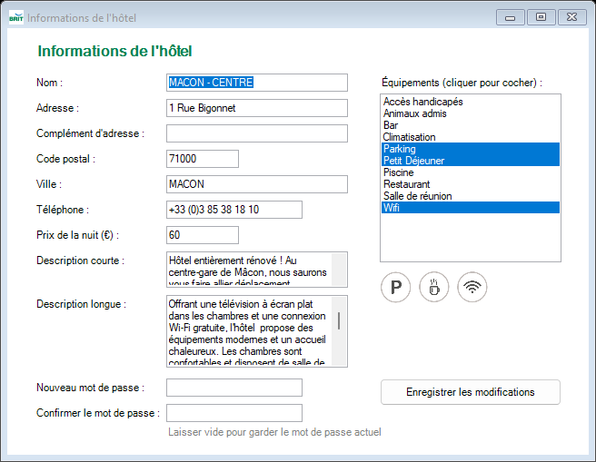
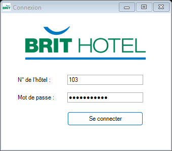
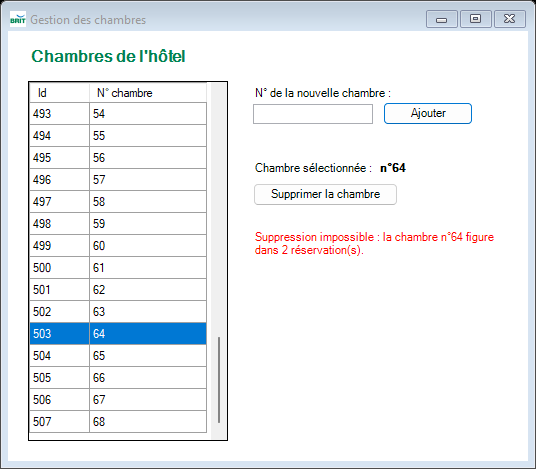
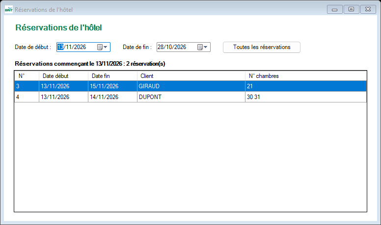
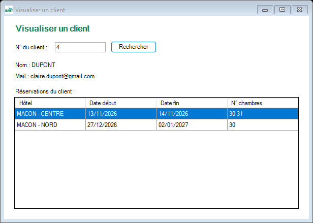
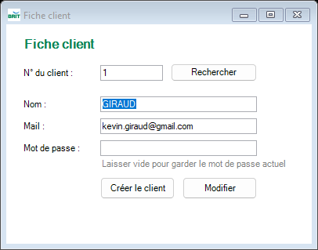
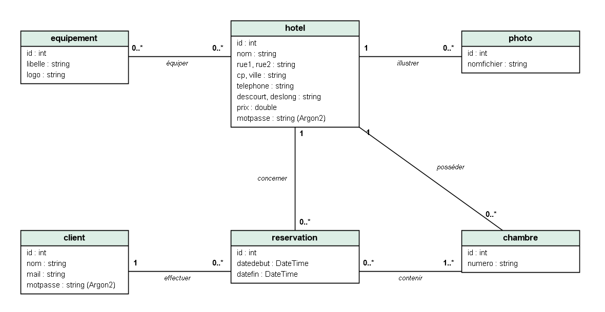

# 🏨 Brit Hotel – Back-office de gestion hôtelière

Application de gestion d'un hôtel du réseau **Brit Hotel**, réalisée en binôme dans le cadre du **BTS SIO option SLAM** (2ᵉ année, Lycée Lamartine – Mâcon).

Le projet suit un cahier des charges en trois phases autour d'une **base de données SQL Server centralisée**, commune à tous les hôtels du groupe :

| Phase | Application | Utilisateurs | Technologies | État |
|---|---|---|---|---|
| **1** | Application de bureau *back-office* | Gérant de l'hôtel | C#, WinForms, .NET Framework 4.8, Entity Framework 6 | ✅ Réalisée |
| **2** | Site Internet *front-office* | Clients | PHP, Laravel / Eloquent | À venir |
| **3** | Application mobile | Clients / personnel | Android (Java), API REST JSON | À venir |

> Projet réalisé **en binôme** avec Dorian LORON MORRA – septembre à novembre 2026.



---

## Sommaire

- [Phase 1 – Application C#](#phase-1--application-c)
- [Base de données](#base-de-données)
- [Installation](#installation)
- [Structure du dépôt](#structure-du-dépôt)
- [Compétences mises en œuvre](#compétences-mises-en-œuvre)

---

## Phase 1 – Application C#

Application Windows Forms (interface MDI) permettant au gérant d'un hôtel d'administrer les données de son hôtel dans la base centralisée.

**Fonctionnalités**

| User story | Formulaire | Description | Développeur |
|---|---|---|---|
| US1 | `FrmConnexion` | Connexion avec le numéro de l'hôtel et son mot de passe, vérifié avec **Argon2** | Mouad |
| US2 | `FrmHotel` | Informations de l'hôtel, **équipements** (avec leurs logos) et changement du mot de passe | Dorian |
| US3 | `FrmChambres` | Ajout et suppression des **chambres** (suppression impossible si la chambre est réservée) | Mouad |
| US4 | `FrmReservations` | **Réservations** de l'hôtel, filtrées par date de début ou de fin | Dorian |
| US5 | `FrmVisualiserClients` | Fiche d'un **client** et toutes ses réservations, dans tous les hôtels du groupe | Mouad |
| US6 | `FrmFicheClient` | Création et modification des **fiches clients** (mot de passe haché) | Dorian |

| Connexion | Informations de l'hôtel |
|---|---|
|  |  |
| **Gestion des chambres** | **Réservations filtrées par date** |
|  |  |
| **Visualiser un client** | **Fiche client** |
|  |  |

**Points techniques**

- Accès aux données avec **Entity Framework 6** (*Database First*) et des requêtes **LINQ** : aucune requête SQL écrite à la main
- Mots de passe des hôtels et des clients **hachés avec Argon2** (`Isopoh.Cryptography.Argon2`), jamais stockés ni affichés en clair
- Gestion des exceptions (`try / catch`) autour de chaque accès à la base, avec des messages clairs dans l'interface
- Contrôle des saisies : champs vides, nombres, longueurs maximales, format et unicité du mail
- Interface MDI : un seul exemplaire de chaque formulaire, charte graphique commune (classe `Charte`)
- Architecture MVC : modèle Entity, vues (formulaires), contrôleurs (méthodes événementielles)

---

## Base de données

Base SQL Server `bdhotel_mouaddorian`, fournie avec le cahier des charges et complétée par un jeu d'essai.



Tables : `hotel`, `chambre`, `client`, `reservation`, `chambre_reservation` (réservation ↔ chambre), `equipement`, `equipement_hotel` (hôtel ↔ équipement), `photo`.

Le script complet (structure + données : 14 hôtels, 715 chambres, 7 clients, 9 réservations) se trouve dans [`database/bdhotel_mouaddorian.sql`](database/bdhotel_mouaddorian.sql).

---

## Installation

### Prérequis

- Visual Studio 2022 avec la charge de travail *Développement .NET Desktop*
- SQL Server (2019 ou plus récent) et SQL Server Management Studio

### 1. Base de données

1. Ouvrir `database/bdhotel_mouaddorian.sql` dans SQL Server Management Studio
2. L'exécuter : le script crée la base `bdhotel_mouaddorian` avec toutes ses données

### 2. Application C#

1. Ouvrir `application-csharp/Hotel.sln` dans Visual Studio
2. Vérifier la chaîne de connexion dans `App.config` : elle pointe vers le serveur `DESKTOP-I007MJU` de l'environnement du lycée ; sur un autre poste, remplacer `data source` par le nom de votre serveur SQL (par exemple `localhost`)
3. Lancer avec **F5** – les paquets NuGet (Entity Framework, Argon2) sont restaurés automatiquement

### Connexion

Chaque hôtel se connecte avec son numéro et le mot de passe `password` suivi de ce numéro, par exemple **103** / `password103` (hôtel MACON - CENTRE).

> ⚠️ Ces mots de passe sont des données de démonstration fournies avec l'exercice.

---

## Structure du dépôt

```
brit-hotel-macon/
├── application-csharp/      # Phase 1 – solution Visual Studio (WinForms + Entity Framework)
│   └── Hotel/               # Formulaires, modèle Entity, ressources
├── database/                # Script SQL (structure + données)
├── docs/                    # Dossier de projet (PDF)
└── screenshots/             # Captures d'écran
```

---

## Compétences mises en œuvre

- Analyse d'un cahier des charges et découpage en *user stories*
- Travail en équipe *Scrum* en binôme, organisation des tâches sur Notion
- Exploitation d'une base de données relationnelle SQL Server
- Développement d'une application de bureau événementielle en **C# / .NET** avec un ORM (**Entity Framework**)
- Sécurisation des mots de passe avec **Argon2**
- Tests (cahier de recette) et gestion des exceptions
- Gestion de versions avec Git / GitHub : une branche par développeur, puis intégration

📄 Le dossier de projet détaillé est disponible dans [`docs/`](docs/).

---

**Mouad TOUNANI** – Étudiant en BTS SIO SLAM · [Portfolio](https://emme-mouad.github.io) · [LinkedIn](https://www.linkedin.com/in/mouad-tounani-312a82385/)

Projet co-réalisé avec **Dorian LORON MORRA**.

*Projet pédagogique : Brit Hotel est cité uniquement comme contexte de l'exercice.*
